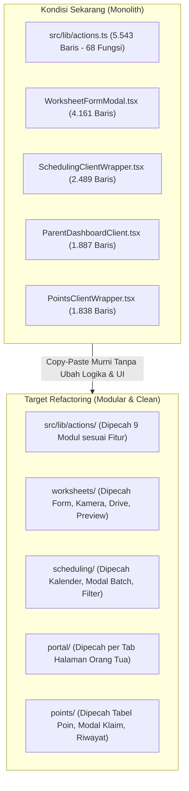

# Rencana Refactoring Arsitektur Kode (Clean Architecture Plan)

> [!IMPORTANT]
> **PRINSIP UTAMA REFACTORING INI (HARGA MATI):**
> 1. **TANPA MERUBAH LOGIKA YANG ADA (Zero Logic Change):** Seluruh *query* Supabase, rumus perhitungan tunggakan (*overdue*), rumus poin, kuota kelas (Reguler & CG), filter absen, hingga validasi berjalan **100% identik** seperti saat ini.
> 2. **TANPA MERUBAH LAYOUT & TAMPILAN YANG ADA (Zero UI/Layout Change):** Seluruh kelas Tailwind CSS, posisi tombol, urutan *dropdown*, animasi, modal, dan responsivitas HP/Desktop **tidak berubah sama sekali**.
> 3. **TANPA MERUSAK DATA LAMA (Zero Data Impact):** Tidak ada perubahan struktur tabel database Supabase.
> 4. **TANPA MERUSAK IMPORT FILE LAIN (Backward-Compatible):** Menggunakan teknik *Barrel Re-export* sehingga halaman yang sudah berjalan tidak akan mengalami *error import*.

---

## 1. Diagnosa Masalah Saat Ini

Saat ini aplikasi memiliki **68 fungsi Server Action** yang menumpuk di dalam **1 file Backend** (`src/lib/actions.ts` — **5.543 baris**) dan beberapa komponen Frontend berukuran raksasa (*God Components* di atas **1.300 – 4.100 baris**).

---

## 2. Fase 1: Refactoring Backend (`src/lib/actions.ts`)

**Strategi Keamanan:**
Kita membuat folder `src/lib/actions/` berisi modul-modul kecil per domain fitur. File `src/lib/actions.ts` yang lama tetap dipertahankan sebagai *jembatan* (*re-exporter*) sehingga seluruh file di `src/app/` dan `src/components/` yang memanggil `import { ... } from "@/lib/actions"` **tetap berjalan normal tanpa perlu diubah**.

### Peta Pemecahan 68 Fungsi di `src/lib/actions.ts`:

| No | File Modul Baru | Fungsi yang Dipindahkan (Beserta Baris Asli) | Estimasi Ukuran |
| :-: | :--- | :--- | :---: |
| **1** | `src/lib/actions/shared-cache.ts` | *Internal Helpers & In-Memory Cache*: • `memoryLabelsCache`, `memoryStatsCache`, `memoryOverdueCache` • `memoryPointsCache`, `memoryTemplatesCache` • `ABSENT_WORKSHEET_OR_FILTER`, `isWorksheetAbsent()` • `getCurrentBranchId()`, `getCurrentUserRole()`, `logActivity()` | ~250 baris |
| **2** | `src/lib/actions/auth-branch.ts` | **Autentikasi, User, & Cabang:** • `syncUserIdentity` (L10) • `setSuperadminBranch` (L106) & `clearSuperadminBranch` (L111) • `getAllUsers` (L2654) & `changeUserPassword` (L2668) • `updateModuleLockPassword` (L4834) • `resetAllDatabaseData` (L2540) | ~350 baris |
| **3** | `src/lib/actions/dashboard.ts` | **Dashboard & Kalkulasi Tunggakan:** • `getDashboardStats` (L228) • `getOverdueWorksheets` (L392) • `getRecentActivities` (L2588) | ~600 baris |
| **4** | `src/lib/actions/students.ts` | **Manajemen Siswa (CRUD & Paginasi):** • `getStudents` (L930) & `getPaginatedStudents` (L5252) • `createStudent` (L1132) & `updateStudent` (L2127) • `deleteStudent` (L2057) • `updateStudentStatus` (L2065) & `updateStudentLabel` (L2116) • `updateStudentAccessPin` (L3341) & `updateStudentPhotoUrl` (L4752) • `getStudentsByStatusWithSchedules` (L2383) | ~1.100 baris |
| **5** | `src/lib/actions/schedules.ts` | **Penjadwalan, Kuota Kelas, & Booking:** • `getStudentScheduleMap` (L774) • `autoBookStudentToClass` (L1245) & `bookStudentManual` (L1454) • `removeStudentBooking` (L1560) & `bulkRemoveStudentBookings` (L1575) • `copyScheduleToNextMonth` (L1591) & `getStudentsWithNextMonthSchedule` (L1696) • `moveStudentBooking` (L1754) & `getMonthlySchedules` (L1808) • `createScheduleSlot` (L1875), `bookStudentToSlot` (L1925), `toggleSlotLock` (L1983) • `cancelBooking` (L2229) • `getSchedulesByDate` (L2337) & `getTodaySchedules` (L2378) | ~1.200 baris |
| **6** | `src/lib/actions/worksheets.ts` | **Lembar Kerja (Worksheets) & Absensi:** • `getWorksheetsByBranch` (L2695) • `getStudentSessionTimes` (L2854) • `createWorksheet` (L2909), `updateWorksheet` (L3086), `deleteWorksheet` (L3296) • `deleteWorksheetMonth` (L3313) • `getWorksheetAttendanceHistory` (L4678) | ~750 baris |
| **7** | `src/lib/actions/portal.ts` | **Portal Orang Tua (Parent Portal):** • `verifyParentAccess` (L3396) • `confirmParentStudentSelection` (L3738) • `getParentSessionStudent` (L3847) & `clearParentSession` (L3955) • `getStudentUpcomingSchedule` (L3961) & `getStudentScheduleHistory` (L3997) • `updateParentFeedback` (L4031) & `updateSingleWorksheetParentFeedback` (L4075) | ~720 baris |
| **8** | `src/lib/actions/points.ts` | **Poin Siswa & Penukaran Hadiah:** • `redeemStudentPoints` (L4523) • `addManualStudentPoints` (L4598) • `getPointRedemptions` (L4647) | ~200 baris |
| **9** | `src/lib/actions/master.ts` | **Data Master (Kelas, Label, Guru, Template, Dokumen):** • `getLabels` (L365), `createLabel` (L2030), `deleteLabel` (L2325) • `createClass` (L2004), `deleteClass` (L2240), `getClassDeletionImpact` (L2273), `getClassesWithSchedules` (L2475) • `getTeachers` (L4115), `createTeacher` (L4143), `updateTeacher` (L4169), `deleteTeacher` (L4192) • `getAssessmentTemplates` (L4220), `createAssessmentTemplate` (L4298), `updateAssessmentTemplate` (L4394), `deleteAssessmentTemplate` (L4502) • `getStudentRulesDocument(s)` & `save/rename/deleteStudentRulesDocument` (L4903–L5053) • `getCurriculumDocuments` & `save/rename/deleteCurriculumDocument` (L5092–L5216) | ~750 baris |

---

## 3. Fase 2: Refactoring Frontend ("God Components")

> [!NOTE]
> **Aturan Ketat Pemecahan Komponen Frontend:**
> Setiap sub-komponen yang dipisahkan hanya memindahkan blok JSX (`
...
`) beserta `props` yang dibutuhkannya. **Tidak ada perubahan `className`, warna, ukuran font, urutan form, maupun perilaku state.**

### 2.1. `WorksheetFormModal.tsx` (`4.161 baris` → Target: `~600 baris` per file)
Saat ini 1 file menangani form nilai, kamera langsung, upload Google Drive, kompresi foto/video, dan pemilih template asesmen.
* **Rencana Pemecahan di `src/components/features/worksheets/form-parts/`:**
  1. `WorksheetMediaUploader.tsx` — Bagian kamera, rekam video, kompresi gambar, dan upload ke Google Drive (**tanpa merubah UI & alur upload**).
  2. `WorksheetAssessmentPicker.tsx` — Bagian *dropdown* & *auto-fill* kalimat penilaian dari Template Asesmen (**tanpa merubah logika pengisian otomatis**).
  3. `WorksheetSessionList.tsx` — Bagian daftar input sesi belajar harian & poin per aktivitas (**tanpa merubah rumus poin & layout form**).
  4. `WorksheetFormModal.tsx` — Tetap menjadi pembungkus utama (*parent modal*).

### 2.2. `SchedulingClientWrapper.tsx` (`2.489 baris` → Target: `~500 baris` per file)
* **Rencana Pemecahan di `src/components/features/scheduling/`:**
  1. `CopyScheduleModal.tsx` — Modal salin jadwal ke bulan depan (**tanpa merubah logika copy & tampilan**).
  2. `ManualBookingModal.tsx` — Modal tambah jadwal manual & indikator kuota kelas (**tanpa merubah hitungan kuota & layout**).
  3. `StudentScheduleDetailModal.tsx` — Modal detail jadwal per siswa & pindah jam/tanggal (**tanpa merubah logika `moveStudentBooking`**).
  4. `SchedulingClientWrapper.tsx` — Fokus pada tampilan tabel/kalender utama dan filter.

### 2.3. `ParentDashboardClient.tsx` (`1.887 baris` → Target: `~450 baris` per file)
* **Rencana Pemecahan di `src/components/features/portal/tabs/`:**
  1. `ParentOverviewTab.tsx` — Tab ringkasan profil siswa, sisa kuota pertemuan, & poin.
  2. `ParentWorksheetTab.tsx` — Tab riwayat laporan harian, foto/video Google Drive, & *feedback* orang tua.
  3. `ParentScheduleTab.tsx` — Tab jadwal mendatang & riwayat kehadiran.
  4. `ParentRulesCurriculumModal.tsx` — Modal baca dokumen peraturan & kurikulum.

### 2.4. `PointsClientWrapper.tsx` (`1.838 baris` → Target: `~450 baris` per file)
* **Rencana Pemecahan di `src/components/features/points/`:**
  1. `RedeemPointsModal.tsx` — Modal penukaran poin siswa.
  2. `ManualBonusPointsModal.tsx` — Modal tambah bonus poin manual.
  3. `PointHistoryModal.tsx` — Modal riwayat klaim & perolehan poin per siswa.

### 2.5. `StudentClientWrapper.tsx` (`1.505 baris`) & `StudentRegistrationForm.tsx` (`1.320 baris`)
* **Rencana Pemecahan di `src/components/features/students/`:**
  1. `whatsappAutofillParser.ts` — Memisahkan fungsi *parsing* teks autofill WhatsApp dari `StudentRegistrationForm.tsx` ke file helper tersendiri (**100% rumus regex/teks sama persis**).
  2. `StudentDetailModal.tsx` — Memisahkan modal detail siswa & PIN akses orang tua dari `StudentClientWrapper.tsx`.

---

## 4. Urutan Eksekusi Bertahap (Step-by-Step) & Checklist Pengujian

Agar 100% aman dan bisa diuji setiap tahapnya, refactoring nantinya dilakukan **bertahap satu per satu** (bukan sekaligus semua file):

### Tahap A — Backend (`src/lib/actions/`) ✅ SELESAI (branch `refactor/clean-code`, commit `836cade`)
- [x] **Langkah A1:** Helper internal yang dipakai lintas modul dipindah ke `src/lib/actions/_internal.ts` (`ABSENT_WORKSHEET_OR_FILTER`, `memoryPointsCache`, `normalizeScheduleTime`, `isMissingColumnError`). File ini sengaja **tanpa** `"use server"` agar helper tidak terekspos sebagai Server Action.
- [x] **Langkah A2–A4:** Dipecah ke `auth-branch.ts`, `dashboard.ts`, `master.ts`, `schedules.ts`, `students.ts`, `worksheets.ts`, `portal.ts`, `points.ts` (masing-masing ber-`"use server"`). `src/lib/actions.ts` kini hanya barrel re-export (84 export, tanpa `"use server"`).
- [x] **Koreksi teknis yang diterapkan:**
  - Variabel `let` cache (`memoryLabelsCache`, `memoryTemplatesCache`, `memoryLockPasswords`) **tetap lokal** di modul yang memakainya (master / auth-branch), jadi tidak ada perubahan perilaku cache.
  - Import `@supabase/supabase-js` yang sebelumnya ada di tengah file dipindah ke atas `auth-branch.ts`.
- [x] **Verifikasi:** skrip pembanding multiset baris → seluruh baris kode asli identik 100%; `npx tsc --noEmit` = 0 error; `npm run build` sukses. Log "Dynamic server usage" saat build sudah ada sejak sebelum refactor (bukan efek refactor).

### Tahap B — Frontend (Per Halaman) ✅ SELESAI (branch `refactor/clean-code`)
- [x] **Langkah B0 (commit `36c26a7`):** Helper murni (tanpa state/JSX) dipindah apa adanya:
  - `StudentRegistrationForm.tsx` → `studentFormUtils.ts` (`SESSION_TIME_GROUPS`, `parseSessionTime`, `parseIndonesianDate`)
  - `WorksheetFormModal.tsx` → `worksheetFormUtils.ts` (`normalizeClientTime`, `normalizeClientDate`, `parseBulletList`, `formatAnandaLine`, `compressImage`, `formatPlainLine`)
- [x] **Langkah B1 (commit `23f01af`):** Pecah `StudentClientWrapper.tsx` (1.505 → 483 baris) & `StudentRegistrationForm.tsx` (1.320 → 746 baris):
  - `src/components/features/students/list/`: `StudentConfirmModal.tsx`, `StudentFilterToolbar.tsx`, `StudentDesktopTable.tsx`, `StudentMobileList.tsx`
  - `src/components/features/students/form-parts/`: `StudentCgScheduleSection.tsx`, `StudentIdentitySection.tsx`, `StudentContactSection.tsx`
- [x] **Langkah B2 (commit `83cfa9c`):** Pecah `PointsClientWrapper.tsx` (1.838 → 926 baris) & `ParentDashboardClient.tsx` (1.887 → 1.016 baris):
  - `src/components/features/points/`: `PointsRedeemTab.tsx`, `PointsHistoryTab.tsx`, `RedeemPointsModal.tsx`, `ManualBonusPointsModal.tsx`, `PointsLockModal.tsx`, `PointHistoryModal.tsx`
  - `src/components/features/portal/tabs/`: `ParentOverviewCard.tsx`, `ParentWorksheetSection.tsx`, `ParentPhotoCropModal.tsx`, `ParentChangePinModal.tsx`, `ParentPointsHistoryModal.tsx`
- [x] **Langkah B3 (commit `644c8de`):** Pecah `SchedulingClientWrapper.tsx` (2.489 → 980 baris):
  - `src/components/features/scheduling/`: `NextMonthReadinessBanner.tsx`, `SchedulingStudentSelector.tsx`, `AutoBookingForm.tsx`, `ManualBookingForm.tsx`, `SchedulingNotificationModal.tsx`, `StudentScheduleDetailModal.tsx`
- [x] **Langkah B4:** Pecah `WorksheetFormModal.tsx` (4.161 → 2.345 baris):
  - `src/components/features/worksheets/form-parts/`: `WorksheetBasicInfoSection.tsx`, `WorksheetAssessmentSection.tsx`, `WorksheetMediaUploader.tsx`, `WorksheetLivePreviewSection.tsx`

---

## 5. Jaminan Keamanan (Safety Guarantees)

| Aspek | Jaminan | Cara Verifikasi |
| :--- | :--- | :--- |
| **Logika Bisnis & Rumus** | **Tidak berubah 1% pun** (Hanya memindahkan posisi fungsi antar file) | Perbandingan *diff* isi fungsi identik 100% |
| **Layout & UI/UX** | **Tidak berubah 1 piksel pun** (Tidak mengubah JSX/Tailwind CSS) | Visual halaman sama persis sebelum & sesudah |
| **Tipe Data & Kompilasi** | **0 Error TypeScript** di setiap langkah | Wajib lulus `npx tsc --noEmit` di tiap langkah |
| **Supabase Egress Optimization** | **Tetap utuh** (Semua *in-memory cache* & filter hemat kuota tetap berjalan di `shared-cache.ts`) | Cache tetap ter-share antar modul action |

