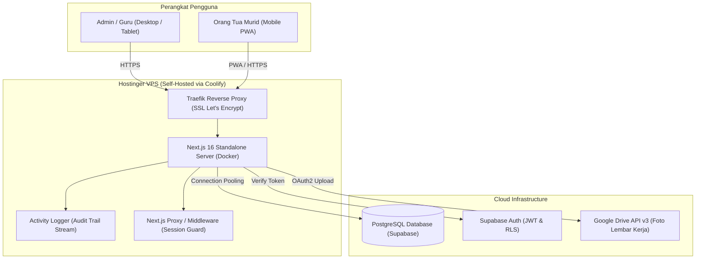

# Spesifikasi Teknis & Tech Stack: ShiningSun PWA Academy & Scheduling System

Dokumen ini disusun sebagai **panduan presentasi teknis (Technical Portfolio & Demo Script)** untuk keperluan wawancara kerja (*tech interview*), pembuktian kompetensi rekayasa perangkat lunak (*software engineering*), dan demo langsung (*live demo*).

---

## 🌟 1. Ringkasan Eksekutif (Executive Summary)

* **Nama Produk**: ShiningSun Preschool & Academy Management System
* **Tipe Aplikasi**: Progressive Web Application (PWA) — Enterprise Multi-Tenancy & School Portal
* **Domain Produksi**: `https://shiningsun.tech` (VPS Self-Hosted via Coolify)
* **Kategori**: EdTech / SaaS Management & Booking System
* **Peran Pengguna (RBAC)**:
  1. **Superadmin**: Akses global multi-cabang, mutasi siswa lintas cabang, kelola kurikulum, audit log.
  2. **Admin Cabang / Guru**: Kelola jadwal sesi kelas, presensi kehadiran, penilaian lembar kerja (*student worksheets*), dan gamifikasi poin.
  3. **Portal Orang Tua (Parent Portal)**: Akses mandiri riwayat belajar, jadwal kelas mendatang, saldo poin hadiah, dan pengisian feedback/evaluasi bulanan.

---

## 🏗️ 2. Tech Stack Lengkap (Full-Stack Breakdown)

### A. Frontend Layer (Modern UI/UX & PWA)
* **Framework**: **Next.js 16 (App Router)**
  * Memanfaatkan arsitektur React Server Components (RSC) untuk efisiensi loading dan Server Actions untuk mutasi data tanpa memerlukan REST endpoint terpisah.
* **Core Library**: **React 19 & React-DOM 19**
  * Memanfaatkan fitur terbaru React 19: asynchronous actions, optimistic UI transitions, dan streaming SSR.
* **Bahasa**: **TypeScript 5 (Strict Mode)**
  * 100% *type-safe* dari database model hingga UI components. Bebas dari `any` liar pada data kritis.
* **Styling & Design System**: **Tailwind CSS v4**
  * Menggunakan engine terbaru Tailwind v4 (`@tailwindcss/postcss` 4) dengan dukungan Dark Mode, responsif mobile-first, dan animasi transisi halus.
* **PWA & Offline Engine**: **Serwist (`@serwist/next` v9.5)**
  * Penerus modern Workbox untuk service worker, caching statis, instalasi *Add to Home Screen*, dan background sync di Android & iOS.
* **Notifikasi**: **Web Push API (`web-push` v3.6)**
  * Dukungan native VAPID push notification ke smartphone pengguna tanpa aplikasi toko (Google Play / App Store).

---

### B. Backend & Data Layer
* **BaaS / Database**: **Supabase (PostgreSQL 15+)**
  * Skema relasional yang dinormalisasi dengan Foreign Keys, Indexing performa tinggi, dan UUID generator.
* **Security & Auth**:
  * **Supabase SSR (`@supabase/ssr`)**: Manajemen cookie session berbasis JWT yang kompatibel dengan Next.js Server Actions dan Middleware.
  * **Row Level Security (RLS)**: Enkapsulasi data per-cabang di level database engine.
  * **Dual Client Pattern**: Pemisahan tegas antara `createClient()` (scoped sesi pengguna) dan `getAdminClient()` (Service Role Key khusus operasi audit/mutasi Superadmin).
* **Cloud Storage & Integrasi**:
  * **Google Drive API v3 (OAuth2 Multipart Upload)**: Media penyimpanan foto lembar kerja siswa tanpa membebani egress database.
  * **Supabase Storage**: Bucket khusus penyimpanan dokumen peraturan & kurikulum bimba.

---

### C. Infrastruktur, DevOps & Server Hosting
* **Infrastruktur VPS**: **Hostinger Cloud VPS (Linux Ubuntu Server)**
* **Orchestration & PaaS**: **Coolify v4 (Self-Hosted PaaS Engine)**
  * Menjalankan aplikasi Next.js dalam container Docker mandiri (*standalone Node.js environment*).
* **Reverse Proxy & SSL**: **Traefik Reverse Proxy**
  * Otomatisasi penerbitan sertifikat SSL (HTTPS) dari Let's Encrypt dengan HTTP-to-HTTPS redirect.
* **Observabilitas & Logging**:
  * **Custom In-Memory & Console Activity Logger**: Sistem audit trail real-time terstruktur per kategori (`[AUTH-ADMIN]`, `[PORTAL-ORTU]`, `[WORKSHEET]`, `[STUDENT]`, `[SCHEDULE]`, `[POINT]`).

---

## 📐 3. Diagram Arsitektur Sistem

---

## 💡 4. Keunggulan Rekayasa Sistem (Engineering Highlights)
*Poin-poin ini adalah "kartu as" yang wajib Anda ceritakan saat interview teknik:*

### 1. Refactoring Arsitektur Monolit ke Domain-Driven Design (DDD)
* **Tantangan**: Awalnya seluruh logika backend menumpuk dalam 1 file `actions.ts` raksasa (>4.000 baris) dan komponen frontend berukuran "God Component".
* **Solusi**: Memecah arsitektur menjadi 9 domain modular di `src/lib/actions/` (`auth-branch`, `dashboard`, `master`, `points`, `portal`, `schedules`, `students`, `worksheets`, `_internal`) serta memecah modal form menjadi sub-komponen terisolasi. Kode menjadi mudah diuji (*maintainable*), terhindar dari *merge conflict*, dan performa *tree-shaking* meningkat drastis.

### 2. Optimasi Supabase Egress & Eliminasi Slowness (90% Bandwidth Saving)
* **Tantangan**: Database Supabase sempat mengalami lonjakan batas egress (bandwidth) karena foto profil siswa disimpan dalam format Base64 (40–80 KB per baris) dan selalu ikut terpanggil di query daftar siswa.
* **Solusi**:
  * Mengisolasi proyeksi kolom: mengecualikan kolom `photo_url` pada query tabel, list, dan paginasi.
  * Menerapkan in-memory cache dengan TTL (2 menit) untuk perhitungan saldo poin siswa.
  * Mengalihkan unggahan foto lembar kerja siswa ke Google Drive API v3 (OAuth2).

### 3. Mengatasi "Token Rotation Race Condition" (Serverless Concurrency)
* **Tantangan**: Pada hosting serverless sebelumnya (Vercel), guru sering ter-logout otomatis saat sedang standby mengisi rapor (1–3 menit) akibat perebutan rotasi refresh token Supabase di middleware.
* **Solusi**:
  * Memasang pengecualian header `isServerAction` pada middleware Next.js agar server action tidak memicu rotasi token ganda.
  * Memigrasikan runtime aplikasi ke VPS mandiri (Coolify/Docker), menghasilkan single persistent execution context yang stabil dan bebas timeout serverless.

### 4. Sistem Keamanan Bertingkat (Defense-in-Depth)
* **Session Guards**: Server actions dilindungi oleh guard `requireUser()` (khusus staf) dan `requireUserOrParent()` (verifikasi ID siswa pada sesi orang tua).
* **RLS Hardening**: Query tingkat database dilindungi Row Level Security berbasis unit cabang.
* **Zero Service Role Exposure**: Kunci sensitif `SUPABASE_SERVICE_ROLE_KEY` diisolasi ketat di sisi server (`admin.ts`) dan diblokir dari sisi client browser.

---

## 🎯 5. Skenario & Panduan Demo (Demo Script untuk Interview)

Jika diminta mendemokan aplikasi dalam 5–10 menit, ikuti alur profesional berikut:

### Skenario 1: Dashboard Superadmin & Multi-Cabang (Durasi: 2 Menit)
1. Buka `https://shiningsun.tech` &rarr; Login sebagai **Superadmin**.
2. Tunjukkan fitur **Pilih Cabang** di header: bagaimana Superadmin bisa berganti unit (misal: Unit Ngunut &rarr; Unit Balesono) secara instan tanpa reload browser.
3. Buka menu **Kelola Siswa** &rarr; Buka form **Edit Siswa**:
   * Tunjukkan fitur **Mutasi Cabang Siswa**: bagaimana siswa dapat dipindahkan unit cabangnya dengan 1 klik, sementara riwayat lembar kerja dan poinnya otomatis ikut tersinkronisasi tanpa hilang.

### Skenario 2: Presensi & Lembar Perkembangan (Durasi: 3 Menit)
1. Buka menu **Laporan Perkembangan** &rarr; Tunjukkan form input lembar kerja murid.
2. Tunjukkan integrasi upload foto kegiatan (Google Drive) dan otomatisasi penambahan poin siswa (+1 poin saat hadir).
3. Buka menu **Poin Kehadiran** &rarr; Tunjukkan sistem saldo poin dan fitur penukaran hadiah (*reward redemption*) yang memiliki validasi batas saldo (*guard* agar poin tidak minus).

### Skenario 3: Portal Orang Tua (PWA Mobile Experience) (Durasi: 2 Menit)
1. Buka browser mobile (atau mode inspect HP di Chrome) &rarr; Akses `https://shiningsun.tech/portal-ortu`.
2. Masukkan nama panggilan siswa dan PIN akses 4 digit (misal: "Feyra").
3. Tunjukkan dashboard mobile orang tua:
   * Menampilkan nama anak, unit cabang aktif, saldo poin real-time.
   * Menampilkan riwayat lembar kerja yang bisa dibuka detailnya oleh orang tua beserta foto kegiatan dan catatan guru.

### Skenario 4: Observabilitas & DevOps di Coolify (Durasi: 2 Menit)
1. Buka panel Coolify di `panel.shiningsun.tech` &rarr; Masuk ke menu **Runtime Logs**.
2. Tunjukkan bagaimana aksi yang baru saja dilakukan pada demo di atas tercatat rapi secara *real-time*:
   * `[PORTAL-ORTU] Login berhasil | siswa=Feyra`
   * `[WORKSHEET] Lembar kerja baru disimpan | hadir=true`
   * `[AUTH-ADMIN] User terautentikasi -> diarahkan ke Dashboard`
3. Jelaskan bahwa Anda mengonfigurasi VPS ini sendiri menggunakan Docker, reverse proxy Traefik, dan automated deployment dari GitHub.

---

## 💬 6. Tanya Jawab Kunci (Q&A Cheat Sheet Saat Interview)

**T: Mengapa memilih Next.js 16 App Router dan bukan Express + React SPA biasa?**
> *J:* "Dengan Next.js 16 App Router, kami mendapatkan arsitektur Full-Stack monorepo yang sangat efisien. Kami memanfaatkan React Server Components untuk mengurangi ukuran bundel JavaScript ke browser HP orang tua, dan Server Actions menghilangkan kebutuhan menulis boilerplates REST API/Axios terpisah. Selain itu, fitur PWA Serwist dan SSR membuat aplikasi terasa seperti aplikasi native di smartphone."

**T: Bagaimana Anda menangani keamanan multi-cabang (multi-tenancy)?**
> *J:* "Kami menerapkan keamanan berlapis (*defense-in-depth*). Di level middleware dan server action, kami memvalidasi sesi dan unit cabang aktif user menggunakan cookie terenkripsi (`httpOnly`). Di level database Supabase, kami mengaktifkan Row Level Security (RLS) dengan kebijakan berbasis `branch_id`. Hal ini menjamin admin cabang Ngunut tidak akan pernah bisa membaca atau memodifikasi data cabang Balesono."

**T: Kenapa beralih dari Vercel ke VPS Coolify?**
> *J:* "Vercel sangat baik untuk frontend statis, tetapi untuk aplikasi sekolah dengan upload file dokumen kurikulum besar, Vercel memiliki limit eksekusi serverless (timeout 10–15 detik) dan masalah konkurensi token rotasi Supabase. Dengan migrasi ke VPS Hostinger via Coolify, aplikasi berjalan di container Docker mandiri tanpa batasan timeout, biaya bulanan tetap/terprediksi (*fixed cost*), dan kami memiliki kontrol penuh atas sistem logging dan audit server."

